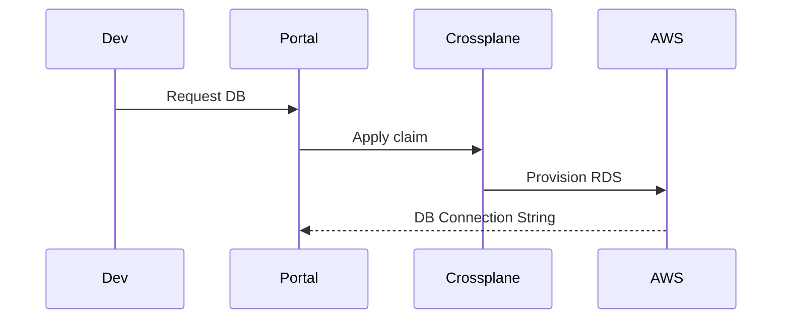
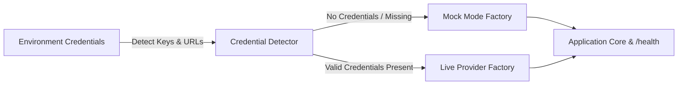

# Platform Architecture Deep Dive
> Maturity: Lab / Reference Implementation

## System Diagram
The following Mermaid.js sequence diagram maps the core workflow and interactions:

This document explains the core Platform Engineering concepts demonstrated in this repository.

## 1. Infrastructure as Code (Terraform)
The `terraform/` directory handles the foundational layer:
- **EKS Provisioning**: We use the official AWS EKS module to spin up a managed Kubernetes control plane and worker nodes.
- **ArgoCD Bootstrapping**: Instead of manually installing ArgoCD, we use the Terraform Helm provider to deploy ArgoCD into the EKS cluster immediately after provisioning. This ensures the cluster is instantly ready for GitOps.

## 2. GitOps Delivery (ArgoCD)
We utilize the **"App of Apps"** pattern in the `argocd-gitops/` directory.
- `root-application.yaml` tells ArgoCD to watch the `argocd-gitops/platform-apps` path in this repository.
- Any new Kubernetes manifest or Helm chart placed in that path is automatically detected and synced to the cluster by ArgoCD.
- This means developers *never* run `kubectl apply`. They simply merge a PR, and ArgoCD handles the state reconciliation.

## 3. Developer Self-Service (Backstage)
Backstage abstracts the complexity of Terraform and Kubernetes away from the application developers.
- The `golden-path-templates/nodejs-microservice/template.yaml` defines a Software Template.
- It uses the Backstage Scaffolder to:
  1. Take user input (Service Name).
  2. Copy the `skeleton/` directory (which contains a Dockerfile and Kubernetes Deployment manifests).
  3. Publish it as a brand new GitHub repository.
  4. Register it in the Backstage Software Catalog (`catalog-info.yaml`).

### The Convergence
When a developer uses the Backstage template, a new repo is created containing Kubernetes manifests. If those manifests are placed in a location ArgoCD is watching, the newly scaffolded service is **instantly deployed** to the EKS cluster without the developer needing to know how Kubernetes or CI/CD works. This is the ultimate goal of Platform Engineering.

## Progressive Credential Loading & Production Architecture (v0.2.0)

This service implements the **Progressive Credential Loading (PCL)** pattern, decoupling development speed from external infrastructure provisioning:

### Core Architecture Components
1. **Mode Detection Singleton:** Inspects environment configuration at boot time without hard crashes on missing secrets.
2. **Dual-Mode Factory Wrappers:**
   - **Storage / Cache:** In-process maps or SQLite `:memory:` transparently promote to managed Redis or PostgreSQL when connection strings are supplied.
   - **AI Providers:** Deterministic heuristic generators and local embeddings transparently promote to live OpenAI, Anthropic, or Gemini API clients.
3. **Hot-Reload & Dynamic TLS:** File watchers monitor mounted volume paths (Kubernetes ConfigMaps and Secrets) to update certificates and limit configs atomically without process restarts.
4. **Health & Observability:** The `/health` endpoint exposes real-time runtime mode metadata (`mock` vs `live`) across all backing adapters.
